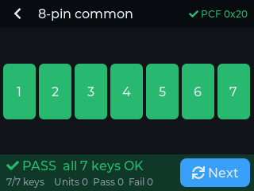
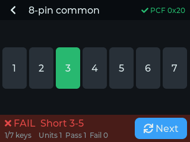
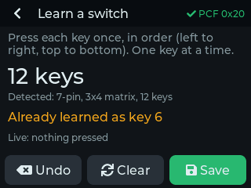
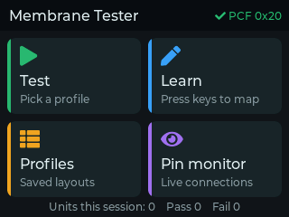
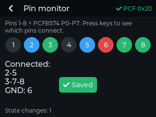
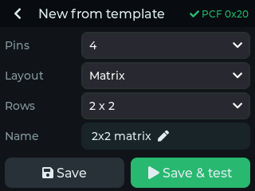

# Membrane Switch Tester

A touch-screen tester for 4–8 pin membrane switches, built on the ESP32-2432S028R ("Cheap Yellow Display") with a PCF8574 I/O expander and an LVGL 9 UI.

It doesn't need to know the switch layout in advance. On every scan it drives each pin low in turn and records which other pins follow it, giving a full pin-to-pin connection map. That map is checked against a profile, so the same hardware handles:

- **Common-contact** switches: one shared pin, one pin per key
- **Matrix** switches: rows × columns
- **Unknown parts**: use **Learn** or **Pin monitor** to work out the pinout

| Test (pass) | Test (fail) | Learn |
| ----------- | ----------- | ----- |
|  |  |  |
| **Home** | **Pin monitor** | **Template builder** |
|  |  |  |

Note *screenshots come from the real UI code running in a desktop LVGL simulator.*

---

## Hardware

### Parts

- ESP32-2432S028R (2.8" ILI9341 + XPT2046 resistive touch)
- PCF8574 or PCF8574A module (the blue breakout boards with address jumpers work fine)
- A connector that fits your membrane tails: 2.54 mm female header, a ZIF/FFC breakout, or a clincher connector wired to a header
- Optional: 8 × 220–330 Ω series resistors between the PCF8574 and the switch connector (protects the expander if you probe something powered)
- Optional: a speaker for audio feedback on key presses, passes, and faults

### Wiring

The CYD's **CN1** connector (4-pin JST 1.25 mm, labelled on the back of the board) carries two free GPIOs:

| CN1 pin | Connect to.       |
| ------- | ----------------- |
| GND     | PCF8574 GND       |
| IO22    | PCF8574 **SCL**   |
| IO27    | PCF8574 **SDA**   |
| 3V3     | PCF8574 VCC       |

```text
 PCF8574            Membrane switch tail
 P0  ─────────────  pin 1
 P1  ─────────────  pin 2
 P2  ─────────────  pin 3
 ...                ...
 P7  ─────────────  pin 8
```

- **Power the PCF8574 from 3.3 V**, not 5 V.
- Leave unused P-pins unconnected. A 4-pin switch uses P0–P3.
- **No pull-up resistors on P0–P7.** The PCF8574's built-in weak pull-ups are what the scan relies on. Most modules already have pull-ups on SDA/SCL.
- Address: any of 0x20–0x27 (PCF8574) or 0x38–0x3F (PCF8574A) is found automatically. The header shows `✓ PCF 0x20` when it's detected.
- Optional extras on the CYD: a small speaker on the **SPEAK** connector beeps on key presses, passes and faults, and the on-board RGB LED lights green on PASS and red on FAIL.

Pin numbers in the UI (1–8) always mean **PCF8574 P0–P7**. Wire switch pin 1 to P0 and the numbers will match the datasheet.

### Electrical notes

- **Contact resistance:** a key reads as closed if it pulls the other pin below ~1 V against the PCF8574's ~100 µA pull-up. That means contacts below ~3 kΩ always register and up to ~10 kΩ usually do. That covers silver and carbon membranes. A key that intermittently fails may be a high-resistance contact, which is a real defect.
- **Diodes:** switches with isolation diodes still work because the scan tests both directions.
- **Ghosting:** in a matrix without diodes, holding 3 keys can make a 4th look pressed. The tester only credits a key when it is the *only* key closed, and shows "One key at a time" otherwise.

### Optional Case

You can 3D print or otherwise fabricate a case to hold the ESP32-2432S028R, PCF8574 module, and membrane switch connector. Ensure the display and touch panel are accessible, and provide openings for the connectors and any optional speaker or RGB LED. I've included a basic 3D-printable design in the [case/](case/) directory as a starting point.


---

## Building and flashing

```bash
pio run -t upload          # build + flash
pio device monitor         # serial log (touch calibration values, PCF8574 status)
```

If the colors look inverted (common on the dual-USB board revision), use `pio run -e cyd_inverted -t upload`. If the picture is garbled rather than just inverted, see the note in `platformio.ini` about the ST7789 driver.

---

## Using it

### Home

Four tiles: **Test**, **Learn**, **Profiles**, **Pin monitor**. The footer shows this session's unit count and pass/fail totals.

### Profiles

A profile is a named list of keys, where each key is a pair of pins. Five templates are created on first boot: 4-, 5- and 8-pin common (common on pin 1), 3×4 matrix (7 pins) and 4×4 matrix (8 pins). Tap a profile to **Test** or **Delete** it (tap Delete twice to confirm).

**+ Template** builds a standard layout from:

- Pin count (4–8)
- Layout: common contact or matrix
- The common pin, or the row/column split (rows are the first N pins)

The last profile used is remembered across power cycles. Profiles are stored in flash (NVS), up to 20.

### Learn: for anything non-standard

1. Connect the switch and open **Learn**
2. Press each key once, **in order**: left to right, top to bottom
3. The screen confirms each key ("Key 5 = pins 2–6") and detects the layout as you go: common, R×C matrix, or custom
4. **Save** asks for a name (the part number works well) and goes straight to Test

Learn catches mistakes: pressing a key twice shows "Already learned as key N", and a press that connects more than two pins is rejected. **Undo** removes the last key. Because keys are stored in the order you press them, the Test grid matches the physical layout.

### Test: production use

1. Connect the unit. If anything is connected at rest, it's flagged immediately as a short or stuck key.
2. Press every key. Tiles turn **blue** while held and **green** once tested.
3. When every key is green and nothing unexpected happened, you get **PASS**, a beep and a green LED.
4. Any connection the profile doesn't explain gives **FAIL** with the reason, e.g. `Short 3-5`, `Key 2 stuck`, `Pin 4 to GND`.
5. Tap **Next** for the next unit. A unit counts as tested if any key was pressed or a fault was seen, and as passed only on a full PASS. An incomplete unit counts as a fail.

### Pin monitor: reverse-engineering

Live view of all 8 pins. Pins that are connected to each other share a colour, and a pin shorted to ground shows red. The text lists each connected group ("2-5", "3-7-8"). Press keys one at a time to map an unknown tail. The "state changes" counter helps spot flaky contacts.

---

## Configuration (`src/config.h`)

| Setting | Default | Notes |
| --- | --- | --- |
| `I2C_FREQ` | 100000 | PCF8574 spec. 400000 usually works and scans 4× faster |
| `DEBOUNCE_SCANS` | 4 | Identical scans needed to accept a change (~16–20 ms) |
| `SCAN_INTERVAL_MS` | 4 | Time between scans |
| `TOUCH_X/Y_MIN/MAX` | 200/3700, 240/3800 | Touch calibration. Every touch prints raw values to serial |
| `TOUCH_INVERT_X/Y`, `TOUCH_SWAP_XY` | 0 | If taps land mirrored or rotated |
| `TFT_ROTATION` | 1 | Landscape, USB on the right. 3 flips it |
| `ENABLE_BEEP` | 1 | Set 0 to silence the speaker |

### Troubleshooting

- **"No PCF8574" in the header:** check SDA/SCL (they're easy to swap), confirm 3.3 V on the module, and run the serial monitor. The tester re-probes every second, so you can fix the wiring without rebooting.
- **Taps land in the wrong place:** touch the four corners, read the raw x/y values in the serial monitor, and update `TOUCH_*` in `config.h`.
- **Every key shows as a short to the next one:** the cable or connector is probably bridging adjacent pins. Check with Pin monitor with no switch connected. Nothing should light up.

---

## Code layout

``` text
src/config.h     pins, calibration, timing
src/model.*      PCF8574 scanner + debounce, profiles (NVS), test & learn logic
src/ui.*         LVGL screens
src/main.cpp     TFT_eSPI / XPT2046 / LVGL glue, beeper + LED
include/lv_conf.h
```

Libraries: LVGL 9.2.2, TFT_eSPI 2.5.43, XPT2046_Touchscreen. Arduino-ESP32 core 2.0.17 (espressif32 platform 6.9.0).

## Other files

- `docs/` contains screenshots and other documentation assets.
- `case/` contains files related to the physical case of the tester
