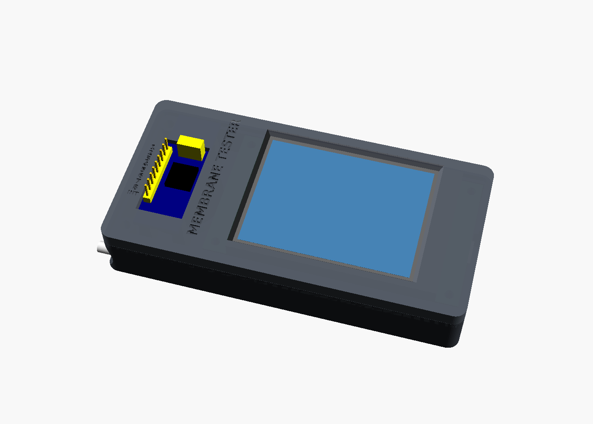

# Case (v2)

The case is parametric OpenSCAD, sized from grid photos of the actual parts. Outside size is **121.6 × 60.9 × 20.7 mm**.

- **Test connector:** the membrane tail plugs straight onto the HW-171's own 9-pin male header (J1). The header comes through a window in the front, left of the screen. The pins stand **6.3 mm** proud of the case. The address jumpers and the chip are visible through the same window.
- **Legend:** "1 … 8" and "INT" are engraved beside the pins.
- **Speaker:** the 28 mm speaker sits in a ring on the floor under the module and fires through a grille in the base.
- **Stylus:** slides into the bottom edge from the left end. A finger scoop lets you pinch the 3 mm that sticks out.
- **Orientation:** USB-C on the right, matching `TFT_ROTATION 1`.

## Files
| File | Print orientation | Notes |
|---|---|---|
| `membrane_tester_fit_test.stl` | flat | **Print this first** (about 10 minutes). See below |
| `membrane_tester_base.stl` | floor down | no supports |
| `membrane_tester_bezel.stl` | face down (already oriented) | no supports |

PLA or PETG, 0.2 mm layers, 3 walls, 20 % infill.

### Fit test
The fit-test plate is a 1.2 mm copy of the front face. It has the screen window, the J1 window, holes at the board's four mounting holes, a notch at the USB-C position, and grooves outlining the PCB and the glass. To use it:
1. Lay it on the CYD.
2. Check that the 4 holes line up with the board's holes, the lit area sits in the window, and the notch lines up with the USB-C.
3. Lay the HW-171 under the small window. The J1 pins and jumpers should poke through.

If anything is off, measure how far and in which direction, and adjust the matching value at the top of the `.scad` file:
- Hole positions: `hole_inset_u` / `hole_inset_v`
- Screen window: `view_u` / `view_v`
- USB-C: `usb_v`

## Prep
1. **HW-171:**
   - Snip **J3** (the right-angle I2C pins) and **J5** (the black female header) flush with the board. They don't fit under the front plate.
   - Solder the 4 wires from the CYD's I2C connector (CN1) into J3's VCC / GND / SDA / SCL holes **from the underside**.
   - J1, the address jumpers and the chip stay as they are.
2. **CYD:** peel off the screen protector's green pull-tab. It sticks out past the top edge of the board.
3. **Speaker:** a dab of hot glue in the ring holds it, cone facing the grille. Plug it into the CYD's SPEAK connector.

## Assembly
1. Drop the speaker into its ring and the CYD onto its 4 pillars.
2. Lay the HW-171 on its 4 posts, J1 toward the outer wall.
3. Fit the bezel. Its window and the small frame on its underside locate the module, and the front plate clamps it down onto the posts.
4. Fit **6 × M3×10** screws from the back. Four go through the board's corner holes and clamp it. Two go into the bay corners. They self-tap into the bezel.
5. Add 4 stick-on bumpers (≤ 8 mm) in the recesses. They lift the speaker grille off the desk.

## Check the pin legend before printing
The pin labels on the HW-171 are hidden under the yellow plastic, so check which end of J1 is P0:
1. Open **Pin monitor**.
2. Touch a jumper wire from **GND** to the J1 pin next to the jumpers.
3. If the screen shows `GND: 1`, the default legend is right. If that pin does nothing (it's INT), set `p0_at_top = false` and re-export the bezel.

## Stylus fit
The bore is 4.5 mm for the 4 × 75 mm stylus, with a 0.25 mm friction rib near the entry:
- If it's too tight, set `stylus_rib = 0`.
- If it's too loose, set it to `0.35`.
